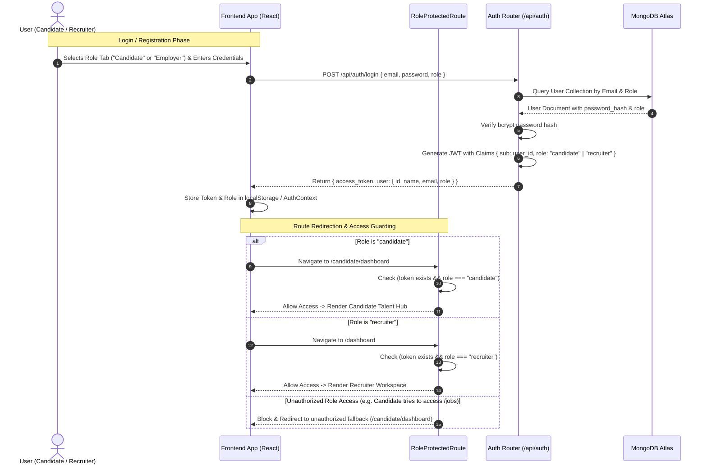
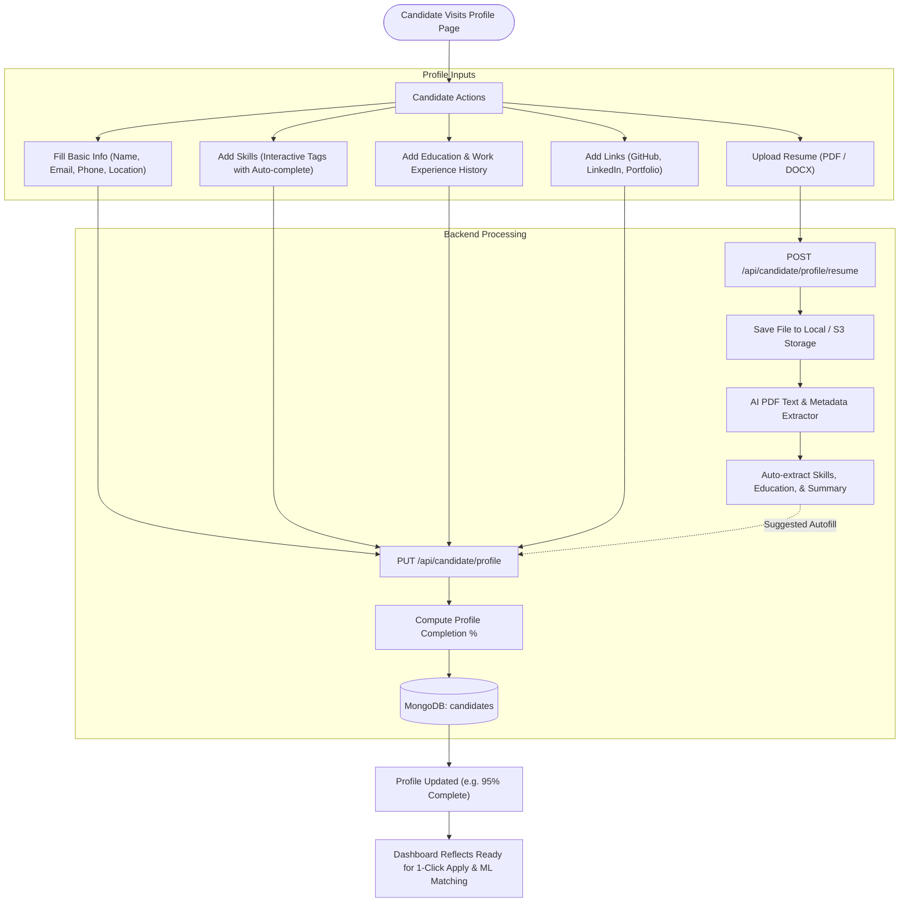
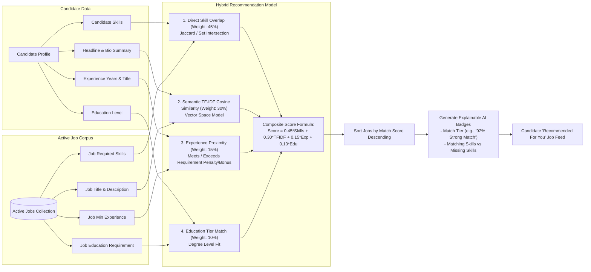
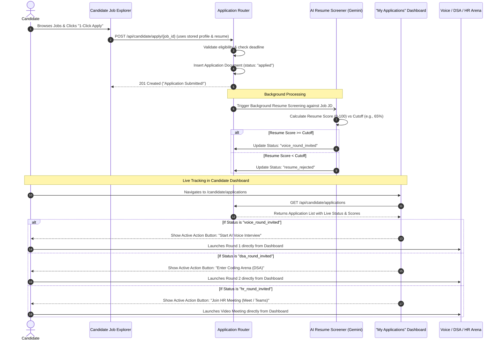
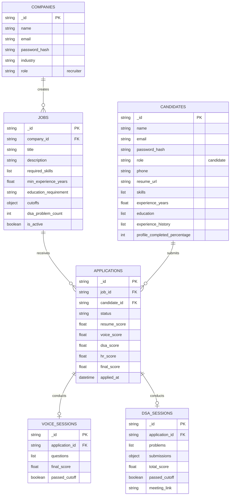

# SmartHire Dual-Portal Architecture & Dataflow Diagrams

This document contains detailed architectural and sequence diagrams illustrating the dataflow, authentication, candidate profile creation, ML job recommendation engine, and application tracking pipeline.

---

## 1. Authentication & Role-Based Access Control (RBAC) Flow

This diagram illustrates how users sign up, log in, receive a role-encoded JWT, and are securely routed to either the **Recruiter Workspace** or the **Candidate Talent Hub**.

---

## 2. Candidate Profile Creation & Resume Ingestion Flow

Shows how candidate profile data and uploaded resumes are processed, stored, and scored for profile completion.

---

## 3. ML Job Recommendation Engine Architecture

Detailed dataflow of how candidate vectors and job requirement vectors are matched using a hybrid scoring algorithm.

---

## 4. 1-Click Application & Real-Time Tracking Pipeline

Illustrates how the candidate applies with one click and monitors their progression through each evaluation stage in their dedicated dashboard.

---

## 5. Entity Relationship (ER) & System Data Model

