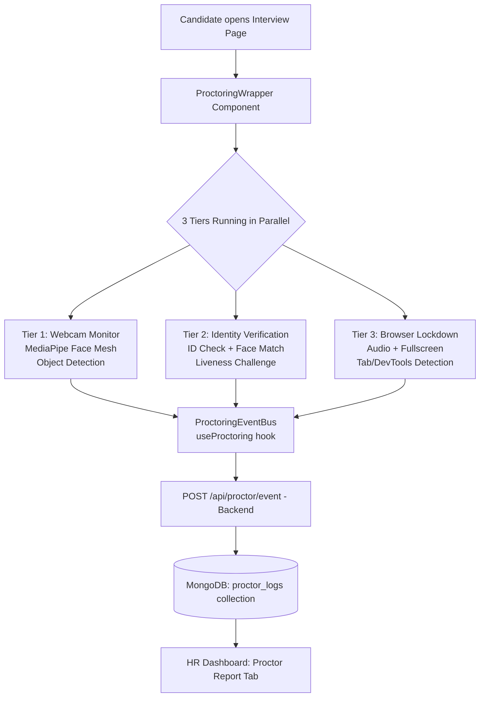

# 🔒 PrismHire — 3-Tier Proctoring System: End-to-End Implementation Plan

> This plan maps the exact files to create or modify inside your existing `c:\ARP` project to implement the complete proctoring system shown in the image. It applies to **both** the Voice Interview (`/interview/voice/:applicationId`) and DSA Round (`/interview/dsa/:applicationId`) pages.

---

## Architecture Overview



---

## New Files to Create

| File | Purpose |
|------|---------|
| `frontend/src/hooks/useProctoring.js` | Master hook — orchestrates all 3 tiers |
| `frontend/src/hooks/useTier1Webcam.js` | Face/gaze/object detection via MediaPipe |
| `frontend/src/hooks/useTier2Identity.js` | ID verification + liveness check |
| `frontend/src/hooks/useTier3Browser.js` | Audio, fullscreen, tab, DevTools, monitors |
| `frontend/src/components/ProctoringWrapper.jsx` | Overlay wrapper that wraps interview pages |
| `frontend/src/components/ProctoringHUD.jsx` | Floating status badges during interview |
| `frontend/src/components/IDVerificationModal.jsx` | ID card capture + face match flow |
| `frontend/src/components/LivenessModal.jsx` | Random action challenge modal |
| `frontend/src/components/ProctoringReportModal.jsx` | HR-side detailed proctor log viewer |
| `backend/app/routers/proctor.py` | New FastAPI router `/api/proctor/*` |
| `backend/app/models.py` | Add `ProctoringEvent`, `ProctoringReport` models |

## Files to Modify

| File | Change |
|------|--------|
| `frontend/src/pages/VoiceInterviewPage.jsx` | Wrap with `<ProctoringWrapper>` |
| `frontend/src/pages/DsaInterviewPage.jsx` | Wrap with `<ProctoringWrapper>` |
| `frontend/src/pages/ApplicationsPage.jsx` | Add "Proctor Report" button per application |
| `backend/app/main.py` | Register `proctor.router` |
| `backend/app/routers/__init__.py` | Add proctor import |

---

## Phase 1 — Backend: Proctor API & DB Schema

### 1.1 MongoDB Collection: `proctor_logs`

Each document stores the full proctoring session for one application:

```json
{
  "_id": ObjectId,
  "application_id": ObjectId,
  "session_type": "voice | dsa",
  "events": [
    {
      "type": "no_face | multiple_faces | gaze_away | object_detected | tab_switch | fullscreen_exit | audio_anomaly | devtools_open | id_verified | liveness_passed | face_mismatch",
      "timestamp": "ISO string",
      "detail": "e.g. 'Phone detected', 'Tab switched to chrome://newtab'",
      "severity": "low | medium | high | critical",
      "snapshot_url": "optional /uploads/proctor_snapshots/<filename>.jpg"
    }
  ],
  "id_verified": false,
  "liveness_passed": false,
  "snapshots": ["url1", "url2"],
  "risk_score": 0.0,
  "risk_level": "low | medium | high | critical",
  "summary": "2 tab switches, 1 gaze violation, phone detected at 14:23",
  "started_at": "ISO",
  "ended_at": "ISO"
}
```

### 1.2 New Backend Router: `backend/app/routers/proctor.py`

**Endpoints to implement:**

```
POST  /api/proctor/{application_id}/start        → Initialize proctor session
POST  /api/proctor/{application_id}/event        → Log a proctor event (batched)
POST  /api/proctor/{application_id}/snapshot     → Upload a flagged frame snapshot
POST  /api/proctor/{application_id}/id-verify    → Submit ID image + face image for comparison
POST  /api/proctor/{application_id}/liveness     → Submit liveness challenge result
GET   /api/proctor/{application_id}/report       → HR fetches full proctor report
POST  /api/proctor/{application_id}/finalize     → End session, compute risk score
```

**Risk score computation (in `finalize`):**

```python
WEIGHTS = {
    "no_face":          2,
    "multiple_faces":   5,
    "gaze_away":        1,
    "object_detected":  4,
    "tab_switch":       3,
    "fullscreen_exit":  2,
    "audio_anomaly":    3,
    "devtools_open":    5,
    "face_mismatch":    10,
    "liveness_failed":  8,
}
# raw_score = sum(WEIGHTS[e.type] for e in events)
# risk_score = min(100, raw_score)
# risk_level = "low" / "medium" / "high" / "critical"
```

### 1.3 Add to `backend/app/models.py`

```python
class ProctoringEventPayload(BaseModel):
    events: List[dict]        # [{type, timestamp, detail, severity, snapshot_url?}]
    session_type: str         # "voice" | "dsa"

class ProctoringSnapshotUpload(BaseModel):
    image_base64: str
    event_type: str
    timestamp: str
```

### 1.4 Register in `backend/app/main.py`

```python
from app.routers import ... , proctor
app.include_router(proctor.router)
```

---

## Phase 2 — Frontend: Tier 3 (Browser Lockdown)

> Start with Tier 3 because it requires **no external ML library** — pure browser APIs. Quickest win.

### `frontend/src/hooks/useTier3Browser.js`

```js
// Detects and reports:
// 1. Fullscreen exit → document.fullscreenElement === null
// 2. Tab / window blur → document.addEventListener('visibilitychange')
// 3. Window blur → window.addEventListener('blur')
// 4. DevTools open → detect via window.outerWidth - window.innerWidth > 160
// 5. Copy/Paste/Right-click blocking (DSA only)
// 6. Multiple monitors → window.screen.isExtended (Window Management API)
// 7. Fullscreen enforcement → auto-request fullscreen on load
```

**Key implementation:**
```js
// Tab switch detection
document.addEventListener('visibilitychange', () => {
  if (document.hidden) logEvent('tab_switch', 'Tab focus lost', 'medium');
});

// DevTools detection (interval check)
setInterval(() => {
  if (window.outerWidth - window.innerWidth > 160 ||
      window.outerHeight - window.innerHeight > 160) {
    logEvent('devtools_open', 'DevTools panel detected', 'critical');
  }
}, 1000);

// Multiple monitors (requires user permission prompt)
if ('getScreenDetails' in window) {
  const screens = await window.getScreenDetails();
  if (screens.screens.length > 1) {
    logEvent('multiple_monitors', `${screens.screens.length} screens detected`, 'high');
  }
}

// Right-click & copy block (DSA page only)
document.addEventListener('contextmenu', e => e.preventDefault());
document.addEventListener('copy', e => e.preventDefault());
document.addEventListener('paste', e => e.preventDefault());
```

---

## Phase 3 — Frontend: Tier 1 (Webcam + MediaPipe)

### Install dependencies

```bash
cd frontend
npm install @mediapipe/face_mesh @mediapipe/camera_utils @mediapipe/drawing_utils
```

### `frontend/src/hooks/useTier1Webcam.js`

```js
// Uses MediaPipe FaceMesh running entirely client-side (no server calls for detection)
// Checks on every frame:

// 1. Face presence — landmarks.length === 0 for > 3 seconds → flag
// 2. Multiple faces — if results.multiFaceLandmarks.length > 1 → flag
// 3. Gaze & head pose — compute nose tip to eye vector; if yaw > 30° → "looking away"
// 4. Object detection — use lightweight COCO-SSD via TensorFlow.js:
//    npm install @tensorflow/tfjs @tensorflow-models/coco-ssd
//    → detect 'cell phone', 'book', 'remote' in frame

// Frame snapshots: when a flag fires, capture canvas.toDataURL() and POST to /api/proctor/.../snapshot
```

**Gaze detection logic (simplified):**
```js
// MediaPipe gives 468 face landmarks
// Key points: nose tip (#4), left eye (#33), right eye (#263)
// If |nose_x - center_x| / face_width > 0.3 → looking away
const noseTip = landmarks[4];
const leftEye = landmarks[33];
const rightEye = landmarks[263];
const faceCenter = (leftEye.x + rightEye.x) / 2;
const gazeDeviation = Math.abs(noseTip.x - faceCenter);
if (gazeDeviation > 0.08) logEvent('gaze_away', 'Looking away from screen', 'medium');
```

---

## Phase 4 — Frontend: Tier 2 (Identity Verification)

### `frontend/src/components/IDVerificationModal.jsx`

Flow:
1. **On interview start** → Show full-screen modal: *"Please hold your government/college ID up to the webcam"*
2. Capture frame → convert to base64 → POST `/api/proctor/{id}/id-verify`
3. Backend uses Gemini Vision API (or face-api.js client-side) to:
   - Extract name/photo from ID
   - Compare ID photo to live webcam face
4. On success → mark `id_verified: true`, close modal, start interview

### `frontend/src/components/LivenessModal.jsx`

Random challenges (shown at session start + random interval):
```js
const CHALLENGES = [
  "Please blink twice slowly",
  "Turn your head to the left",
  "Turn your head to the right",
  "Nod your head up and down",
  "Look up at the ceiling briefly",
];
// Pick random challenge → detect via MediaPipe landmark movement within 5s
// Success → log 'liveness_passed' | Fail → log 'liveness_failed' + flag
```

### `backend/app/routers/proctor.py` — ID Verification endpoint

```python
@router.post("/{application_id}/id-verify")
async def verify_id(application_id: str, payload: IDVerifyPayload):
    # 1. Decode base64 images (id_image, face_image)
    # 2. Use Gemini Vision: "Compare these two face images. Is it the same person?"
    # 3. Extract name from ID text (OCR via Gemini)
    # 4. Return: { matched: bool, confidence: float, name_extracted: str }
```

---

## Phase 5 — Frontend: ProctoringWrapper & HUD

### `frontend/src/components/ProctoringWrapper.jsx`

```jsx
export default function ProctoringWrapper({ applicationId, sessionType, children }) {
  const proctor = useProctoring({ applicationId, sessionType });
  
  return (
    <>
      {/* Fullscreen-enforced container */}
      <div ref={proctor.containerRef} style={{ width: '100vw', height: '100vh' }}>
        
        {/* Hidden video for webcam feed */}
        <video ref={proctor.videoRef} style={{ display: 'none' }} />
        
        {/* Canvas for MediaPipe processing */}
        <canvas ref={proctor.canvasRef} style={{ display: 'none' }} />
        
        {/* Floating HUD badges */}
        <ProctoringHUD status={proctor.status} flagCount={proctor.flagCount} />
        
        {/* ID Verification modal (blocks interview until done) */}
        {proctor.showIdModal && <IDVerificationModal ... />}
        
        {/* Liveness challenge modal */}
        {proctor.showLiveness && <LivenessModal ... />}
        
        {/* Actual interview content */}
        {proctor.idVerified && children}
      </div>
    </>
  );
}
```

### `frontend/src/hooks/useProctoring.js`

Master orchestrator that:
- Calls `useTier1Webcam`, `useTier2Identity`, `useTier3Browser`
- Batches events and flushes to backend every **10 seconds** (or immediately for critical events)
- Exposes `{ status, flagCount, videoRef, canvasRef, containerRef, showIdModal, showLiveness, idVerified }`

### `frontend/src/components/ProctoringHUD.jsx`

Small floating badge in the corner showing:
```
🟢 Proctoring Active  |  ⚠️ 2 Flags
[Webcam ✓] [ID ✓] [Fullscreen ✓]
```

---

## Phase 6 — Integrate into Interview Pages

### `DsaInterviewPage.jsx` (lines ~1-30, wrap existing JSX):

```jsx
import ProctoringWrapper from '../components/ProctoringWrapper';

// Wrap the entire return with:
return (
  <ProctoringWrapper applicationId={applicationId} sessionType="dsa">
    {/* existing DSA page JSX */}
  </ProctoringWrapper>
);
```

### `VoiceInterviewPage.jsx`:
```jsx
return (
  <ProctoringWrapper applicationId={applicationId} sessionType="voice">
    {/* existing voice page JSX */}
  </ProctoringWrapper>
);
```

---

## Phase 7 — HR Dashboard: Proctor Report

### Add to `frontend/src/pages/ApplicationsPage.jsx`

For each application card, add a **"🔍 View Proctor Report"** button that opens `ProctoringReportModal`.

### `frontend/src/components/ProctoringReportModal.jsx`

Displays:
- **Risk Score badge** (color-coded: green/yellow/orange/red)
- **Identity Verification** status (✓ verified / ✗ failed) + confidence %
- **Timeline of Events** — sortable, filterable table:
  | Time | Event Type | Severity | Detail |
  |------|-----------|----------|--------|
  | 14:03:22 | Tab Switch | Medium | Window blurred |
  | 14:07:45 | Object Detected | High | Phone detected |
  | 14:12:01 | No Face | High | Face absent 5s |
- **Flagged Snapshots carousel** — timestamped images saved as evidence
- **Summary** — AI-generated one-paragraph risk summary

---

## Phase 8 — Audio Monitoring (Tier 3 Extension)

Audio monitoring runs entirely client-side for privacy:

```js
// useTier3Browser.js addition:
const stream = await navigator.mediaDevices.getUserMedia({ audio: true });
const audioCtx = new AudioContext();
const analyser = audioCtx.createAnalyser();
const source = audioCtx.createMediaStreamSource(stream);
source.connect(analyser);

// Check RMS every 500ms — if RMS is high AND candidate is not speaking → second voice
setInterval(() => {
  const data = new Uint8Array(analyser.frequencyBinCount);
  analyser.getByteFrequencyData(data);
  const rms = Math.sqrt(data.reduce((s, v) => s + v * v, 0) / data.length);
  if (rms > BACKGROUND_NOISE_THRESHOLD) {
    logEvent('audio_anomaly', `Background audio level: ${rms.toFixed(0)}`, 'medium');
  }
}, 500);
```

---

## Phased Execution Order (Recommended)

| Phase | What to Build | Est. Time |
|-------|--------------|-----------|
| **1** | `proctor.py` router + MongoDB schema + models | 2-3h |
| **2** | `useTier3Browser.js` + fullscreen enforcement + tab/devtools detection | 2h |
| **3** | `useProctoring.js` + `ProctoringWrapper.jsx` + HUD | 2h |
| **4** | Wrap `DsaInterviewPage` + `VoiceInterviewPage` | 30min |
| **5** | `useTier1Webcam.js` — MediaPipe face + gaze + object detection | 4-5h |
| **6** | `IDVerificationModal.jsx` + `/id-verify` backend endpoint | 3h |
| **7** | `LivenessModal.jsx` + liveness detection via MediaPipe | 2h |
| **8** | `ProctoringReportModal.jsx` + HR dashboard integration | 2h |
| **9** | Audio monitoring + risk score engine | 2h |

**Total: ~20 hours of focused development**

---

## Key npm Packages

```bash
# MediaPipe (face mesh, gaze detection — runs client-side, no server calls)
npm install @mediapipe/face_mesh @mediapipe/camera_utils

# TensorFlow.js + COCO-SSD (object detection — phone, book detection)
npm install @tensorflow/tfjs @tensorflow-models/coco-ssd

# face-api.js (alternative for ID face comparison if not using Gemini Vision)
npm install face-api.js
```

---

## Key Backend Package

```bash
# Pillow for image processing (already likely installed, but confirm)
pip install Pillow

# No new heavy dependencies needed — Gemini Vision API handles ID verification
```

---

> [!IMPORTANT]
> **Start with Phase 1 (Backend) + Phase 2 (Tier 3 Browser)** — these have zero external ML dependencies and will give you a working proctoring backbone in 4-5 hours. You can then layer on MediaPipe (Tier 1) and ID verification (Tier 2) incrementally.

> [!NOTE]
> All webcam/audio ML processing runs **client-side** via MediaPipe and TensorFlow.js — no video is ever sent to the server. Only text event logs and occasional snapshots (JPEG, ~50KB) are sent to the backend. This keeps latency low and costs minimal.

> [!TIP]
> For **ID verification**, use the Gemini Vision API since you already have `GEMINI_API_KEY` configured. Send both the ID crop and the live face as base64 images and ask Gemini to compare them — no need for a separate face-recognition service.
